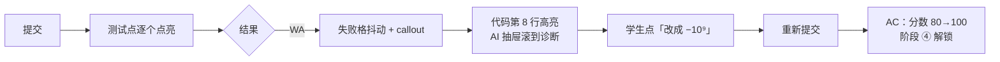
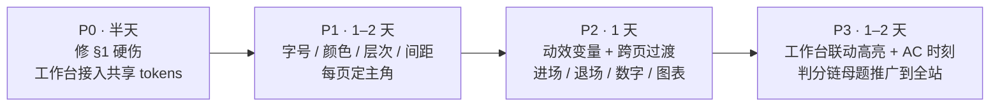

# 智判 OJ 原型 · 设计评审与改进指导

> 范围：`prototype/app/` 下 15 个页面，在 1440×900 下用无头 Chrome 截图走查，并通读了 [tokens.css](file:///D:/毕设/agent%20oj/prototype/app/styles/tokens.css)、[components.css](file:///D:/毕设/agent%20oj/prototype/app/styles/components.css)、[shell.css](file:///D:/毕设/agent%20oj/prototype/app/styles/shell.css)、[workbench.css](file:///D:/毕设/agent%20oj/prototype/app/styles/workbench.css)。

## 0. 总评：为什么“能用，但不够好”

底子其实不错：变量体系清楚，判题状态色成体系，阴影带了底色相，也考虑了减弱动效。问题不在“哪里丑”，而在下面 4 个**结构性**原因：

| # | 根因 | 表现 |
|---|---|---|
| 1 | **每块内容音量一样** | 所有东西都是「白底 + 1px 边框 + 10px 圆角 + 13px 字」。页面没有主角，眼睛不知道先看哪。 |
| 2 | **字号层级太扁、字重只有一档** | 11.5 / 12.5 / 13 / 15 / 19 px 挨得太近，标题基本只用 500。`--ink3 #55637A` 和 `--ink4 #64748B` 肉眼几乎分不出来。 |
| 3 | **动效只停在“悬停变色”** | 除了工作台，动效没有用来表达**因果**（东西从哪来、到哪去、状态怎么变的），也没有“高光时刻”。 |
| 4 | **两套设计系统并存** | `workbench.css` 自己又定义了一遍变量和 reset，结果出现了肉眼可见的不一致（见 §1）。 |

改进顺序：**先修硬伤 → 再定层级（字、色、面） → 再理交互路径 → 最后加动效。** 层级没理顺就加动效，只会更乱。

---

## 1. 先修的硬伤（P0，半天就能改完）


| 问题 | 位置 | 改法 |
|---|---|---|
| 工作台顶栏的「题库 / 作业 / 提交记录 / 学情」和面包屑**带下划线** | `workbench.css` 的 reset 里缺 `a{text-decoration:none}` | 短期：补上这条。长期：工作台直接引用 `tokens.css` + `components.css`，删掉重复的 `:root`。 |
| #1024 在题库里写的是 **简单**，在工作台里是 **中等** | `shell.js` 数据 vs `s-workbench.html` 第 59 行 | 统一数据源。演示时被老师看到会直接影响可信度。 |
| 教师概览的「**模型通道异常**」条目挂着一个绿色「**正常**」标签 | `t-dashboard.html` | 标题和状态互相矛盾。改成「模型通道 · 4/4 在线」，**只有真出异常时才进待处理列表**。 |
| 「待批改 **0** 份」占了一整张统计卡 | `t-dashboard.html` | 值为 0 又没有动作的指标不该占首屏。换成「待复核查重 1」这类能点进去处理的。 |
| 题库每行同时有 👁 和「开做」两个按钮，AC 率也出现了两次（副标题一次、进度条列一次） | `s-problems.html` | 整行可点开详情，👁 删掉；副标题去掉「AC 88%」。 |
| 监考页同一组数字出现了 **4 次**（顶部条、筛选标签、底部统计、右侧概况） | `t-monitor.html` | 只保留筛选标签上的计数和右侧概况，删掉底部那排统计卡。 |
| 难度点 `•••` 截图里看三颗都是亮的，颜色用了蓝 / 红 / 紫 | `shell.css` `.lvl` | 和主色、WA、MLE 撞色，见 §2.3。 |
| 全局减弱动效写的是 `animation-duration:.001ms!important` | `components.css` 第 377 行 | 一刀切反而会让一些动画更突兀，见 §4.5。 |

---

## 2. 视觉审美

### 2.1 每页只定一个主角

后台模板感最大的来源是：**每页都是「标题 + 4~5 张统计卡 + 图表 + 表格」**。先问一句“用户来这页最想干什么”，那个东西就是主角，要比其他元素**大一号、重一级、位置更靠前**。

| 页面 | 现在的视觉重心 | 应该的主角 | 怎么改 |
|---|---|---|---|
| 学生 · 题库 | 一条细进度条 + 表格 | **下一道该做的题** | 顶部换成「继续做题」卡：题名、截止时间、上次停在哪个测试点、一个大按钮。统计数字缩成卡片右侧一行小字。 |
| 学生 · 学情 | 4 张统计卡 | **AI 学情解读 + 薄弱点** | 把蓝色解读条升级成首屏主卡（标题 16/600、正文 14），薄弱点直接接「去练习」。统计卡降成一行横排。 |
| 教师 · 概览 | 5 张统计卡 | **待处理事项** | 待处理移到左上、加宽，每条带行内动作按钮（发布 / 复核），不要只给一个 `›`。 |
| 教师 · 监考 | 48 张一样大的学生卡 | **异常学生** | 异常排最前，从网格里分出来单独一组；普通卡缩小、降低对比度。 |
| 工作台 | 判分链里的红色 3 号块 | 代码 + 失败点 | 方向没错，见 §3.2。 |

### 2.2 字体层级：拉开差距，少而分明

现在 6 级字号里有 4 级挤在 11.5–15px。建议改成**差距更大、级数更少**，字重只用 400 / 500 / 600 三档：

```css
/* tokens.css 建议替换 */
--fs-xs:12px;    /* 元信息、表头          400 */
--fs-sm:13px;    /* 表格、密集列表          400 */
--fs-md:14px;    /* 正文：题面、AI 回复     400，行高 1.75 */
--fs-lg:16px;    /* 卡片 / 区块标题         600 */
--fs-xl:22px;    /* 页面标题               600 */
--fs-2xl:30px;   /* 关键数字               600，tabular-nums */

/* 文字色压到 3 级，删掉 ink3 */
--ink:#0F172A;   /* 标题、关键数据 */
--ink2:#475569;  /* 正文 */
--ink3:#94A3B8;  /* 辅助、占位、禁用 */
```

要点：
- **阅读型内容（题面、AI 回复）用 14px / 行高 1.75。** 中文 13px 连读几段很累，AI 抽屉尤其明显。
- **密集型内容（表格、监考卡）保持 13px**，用字重和颜色分层，别靠字号。
- **页面标题 22/600 + 副标题 13/ink3**，和正文之间要有一眼就能看出来的落差。
- 数字（分数、AC 率）一律 `tabular-nums` + 600，单位降一级、换浅色（`stat-v .u` 已经这么做了，保持）。

### 2.3 颜色：给每种颜色只派一个任务

现在蓝色同时承担了主按钮、选中态、图表主序列、难度「简单」、链接、AI 标签……用得太满，主按钮就不突出了。

**分工原则：**

| 颜色 | 只用来 | 不要再用来 |
|---|---|---|
| 主色蓝 | 主操作、当前选中、图表里的**焦点序列** | 难度、普通标签、装饰图标 |
| 判题色（AC 绿 / WA 红 / TLE 橙…） | **判题结果**及其直接派生（分数、测试点） | 难度、知识点掌握度 |
| 紫色 | AI 相关 | 其他 |
| 中性灰 | 其余所有东西 | — |

**具体改法：**
- **难度** 不要用颜色，改用「实心格数」：`▮▮▯▯▯` 表示 2/5，统一中性色。颜色留给判题。
- **图表** 用同一色相的深浅来区分序列。比如教师概览「提交 vs 通过」：提交 = `#E2E8F0`，通过 = `--blue`，**做成堆叠或重叠**，别用蓝 + 薄荷绿两个高饱和色并排。学情页「AC vs 未通过」同理：未通过用浅灰，红色只留给真正要警示的地方。
- **标签减负**：`.tag` 去掉边框，只留浅底。现在一行里有标签框、分数框、👁 按钮框、开做按钮框，4 种框 × 12 行，满屏都是小方块。
- **监考异常卡**：现在是整张卡填粉色，11/48 张都是粉的，画面很躁。改成**左侧 3px 红色色条 + 红色状态字**，整卡填色只留给「断线」这种最严重的状态。

### 2.4 层次：不是所有东西都要装进卡片

现在只有一种容器（卡片），所以看不出层次。建议分 3 层：

```
画布 (--bg)          ← 页面底
  └ 分区 (无边框)     ← 统计条、筛选栏：直接放在画布上，靠间距分组
      └ 卡片 (--panel + --sh-1, 无边框或极淡边框)  ← 真正的内容容器
          └ 浮层 (--sh-pop)  ← 抽屉、弹窗、下拉、callout
```

- **统计卡合并成一条横带**，中间用竖线分隔（监考页底部那排其实就是这个形态，反而比上面的独立卡好看）。
- 卡片圆角 10 → **12**，控件圆角保持 6，外大内小更有层次。
- 卡片用「阴影代替边框」或「边框 + 极淡阴影」二选一，全站统一。

### 2.5 间距：回到 8pt 网格

现在有 `13px 15px`、`11px 16px`、`9px 12px` 这类零散值。统一成 4 的倍数：控件内 8 / 12，卡片内 **20**，卡片之间 **16**，区块之间 **24–32**。区块间距加大是让页面“透气”最便宜的办法。

### 2.6 给产品一个“签名”

现在整体是标准的 Tailwind slate 后台风，好看但没有记忆点。你其实已经有一个很好的独有视觉元素：**判分链（10 格测试点）**。把它做成全站的视觉母题：

- 题库每行：用一条 10 格**迷你判分链**代替「80 分」标签，一眼就能看出卡在哪个点。
- 提交记录：每条提交都带迷你链，几条排下来就能看出“从 8/10 到 10/10”的过程。
- 学情 / 班级学情：测试点通过热力图也用同样的格子语言。
- AI 四阶段轨道（①②③④）同理，可以在作业列表里用作“这道题 AI 帮到了哪一步”。

演示答辩时，“这是我们的判分链语言”比“这是一个表格”有说服力得多。

---

## 3. 交互逻辑

### 3.1 通用原则

1. **每页一个主操作**，用主按钮；其他一律 ghost / text。教师概览右上「班级学情 + 新建活动」可以，题库「提交记录 + 继续上次」也可以，但页面中间不要再出现蓝色实心按钮。
2. **渐进披露**：表格行里次要操作默认隐藏，悬停 / 聚焦时才出现，行本身可点。
3. **每个异步操作都要走完 4 个状态**：点击（100ms 内必须有反馈）→ 进行中（按钮宽度不变，只换内容，你已经这么做了 👍）→ 成功 / 失败 → **可撤销**（“已全部处理 · 撤销”toast，5 秒）。
4. **空态、加载、出错**每个列表都要有。`.state` 组件已经有了，但页面里基本没用上；加载用骨架屏，不要只放转圈。
5. **顶栏右侧的 ⓘ 图标**没有明确用途，去掉或换成「快捷键」入口。

### 3.2 工作台：把“修错闭环”串成一条线

这是整个系统的核心卖点，交互要像一个**引导好的故事**：



具体建议：
- **联动高亮**：鼠标停在判分链第 3 格 ↔ 代码第 8 行 ↔ AI 抽屉里的「丢分定位」卡，三处**同时高亮**。这是让人觉得“这东西真智能”的关键细节，实现成本很低（共享一个 `focusCase` 状态即可）。
- **AI 抽屉减层**：现在从上到下有 模型切换 → 上下文 → 思考过程 → 正文 → 推荐问题 → 丢分定位 → 开放条件 / 当前模型 → 阶段 4 锁 → 底栏配额 → 输入框，**10 层**。建议：
  - 模型切换收进抽屉头部的下拉（大部分人不会频繁切）。
  - 「开放条件 / 当前模型」删掉或收进 ⓘ 悬浮提示。
  - 「阶段 4 锁」已经在右侧窄轨上了，抽屉里不用重复。
  - 留下：**上下文 → 回答 → 丢分定位 → 推荐追问 → 输入框**。
- **提示次数只显示一处**（现在底栏和窄轨都有），并在发送前提示“这次会消耗 1 次提示”。
- **底部判分带常驻约 145px**，占了编辑器不少高度。没在判题时收成 40px 的摘要条（`WA 80/100 · 首个失败点 #3`），提交时再展开。
- **快捷键**：`Ctrl+Enter` 提交、`Ctrl+'` 运行，并在按钮的 tooltip 里写出来。

### 3.3 列表页（题库 / 提交记录 / 题目管理）

- 筛选栏现在把「状态 + 难度 + 搜索 + 排序」全挤在一行、全做成同样的按钮。**状态**用分段控件（互斥），**难度**收成下拉多选，**排序**放到表头点击。
- 点一行 → **右侧抽屉看详情**，不跳页；抽屉里放「开做」主按钮。
- 筛选变化时，结果数字和列表要有过渡（见 §4），否则用户不确定点没点上。

### 3.4 教师端

- **概览 · 待处理**：每条带行内动作（发布 / 去复核），处理完这一条**原地划掉并收起**，右上角计数跟着减少。
- **监考 · 实时事件**：点一条事件 → 左侧网格**滚到该学生并闪一下**；新事件从顶部滑入，不要整列表刷新。
- **查重**：两份代码对比时，相似片段左右对齐、滚动联动，这是查重页的主角。

---

## 4. 交互动效

### 4.1 原则

动效只做 3 件事：**解释因果**（东西从哪来、到哪去）、**确认操作**（我点到了）、**少量庆祝**（AC 那一刻）。不为了“动”而动。

### 4.2 动效变量（替换 tokens.css 里的动效部分）

```css
/* 时长：按“移动距离 / 元素大小”分级 */
--dur-1:120ms;   /* 悬停、按下、颜色变化 */
--dur-2:200ms;   /* 下拉、tooltip、标签切换 */
--dur-3:280ms;   /* 抽屉、面板展开、卡片进入 */
--dur-4:480ms;   /* 页面级、数字滚动、图表生长 */

/* 缓动：进场减速、退场加速、移动两头缓 */
--ease-out:cubic-bezier(.16,1,.3,1);     /* 进场 */
--ease-in:cubic-bezier(.4,0,1,1);        /* 退场：时长约为进场的 70% */
--ease-move:cubic-bezier(.65,0,.35,1);   /* 位置移动、分段控件滑块 */
--ease-spring:cubic-bezier(.34,1.56,.64,1); /* 只给“庆祝”用，克制 */
```

### 4.3 动效清单（按性价比排序）

| 优先级 | 场景 | 做法 |
|---|---|---|
| ★★★ | **跨页切换** | 原型是多页 HTML，加 `@view-transition{navigation:auto}`，侧栏给 `view-transition-name:side` 保持不动，内容区淡入淡出。**改动约 10 行，整体质感提升最明显。** |
| ★★★ | **页面进场** | 内容区块依次淡入上移 8px，每块间隔 40ms，最多 6 块。 |
| ★★★ | **判题** | 已有逐格点亮 👍。补上：WA 时失败格**放大 + 抖动一次**再弹出 callout；AC 时 10 格从左到右扫一道绿光，分数 80→100 **数字滚动**，窄轨 ④ 的锁 → ✓ 变形。 |
| ★★ | **统计数字** | 首次进入视口时从 0 滚到目标值（480ms，ease-out），`tabular-nums` 防抖动。 |
| ★★ | **图表** | 柱子从底部长出来（`transform:scaleY` + `transform-origin:bottom`，逐根延迟 30ms），不要动 `height`。 |
| ★★ | **抽屉 / 弹窗退场** | 现在只有进场动画，关闭是瞬间消失。补上退场（`@starting-style` + `transition-behavior:allow-discrete`，见下）。 |
| ★★ | **折叠面板**（AI「思考过程」） | `interpolate-size:allow-keywords` 让 `height:0 → auto` 直接过渡；不支持的浏览器会直接跳到目标高度，不影响使用。 |
| ★★ | **AI 回复** | 逐段流式出现 + 末尾闪烁光标；推荐追问在回复结束后再淡入。 |
| ★ | **列表插入**（实时事件、提交记录） | 新条目从高度 0 展开 + 淡入，背景短暂高亮 1 秒后褪去。 |
| ★ | **按钮按下** | `scale(.97)`，120ms。现在的 `translateY(.5px)` 几乎感觉不到。 |
| ★ | **卡片悬停** | 只给**可点击**的卡片加上浮 1px + 阴影加深；不可点的卡片不要有悬停效果（现在 `.stat:hover` 有，会误导用户以为能点）。 |

### 4.4 代码示例

**跨页过渡**（加到所有页面共用的 css）：

```css
@media (prefers-reduced-motion: no-preference){
  @view-transition{ navigation:auto; }
}
.side{ view-transition-name:side; }       /* 侧栏切页时不动 */
.topbar{ view-transition-name:topbar; }
::view-transition-old(root){ animation:var(--dur-2) var(--ease-in) both vt-out; }
::view-transition-new(root){ animation:var(--dur-3) var(--ease-out) both vt-in; }
@keyframes vt-out{ to{ opacity:0; } }
@keyframes vt-in { from{ opacity:0; transform:translateY(6px); } }
```

> Chrome / Edge 126+、Safari 18.2+ 支持，Firefox 会直接普通跳转，不影响功能。之后迁移到 Vue 3 时，改用 Vue Router 的 `<Transition>` 或 `document.startViewTransition()` 即可。

**页面进场依次出现**：

```css
@media (prefers-reduced-motion: no-preference){
  .page > *{
    animation:rise var(--dur-3) var(--ease-out) both;
    animation-delay:calc(var(--i, 0) * 40ms);
  }
}
@keyframes rise{ from{ opacity:0; translate:0 8px; } }
```
```html
<div class="page-head" style="--i:0">…</div>
<div class="stats"     style="--i:1">…</div>
<div class="split"     style="--i:2">…</div>
```

**抽屉进场 + 退场**（替换现在只有进场的 `.drawer`）：

```css
.drawer{
  translate:0; opacity:1;
  transition:translate var(--dur-3) var(--ease-out),
             opacity   var(--dur-3) var(--ease-out),
             display   var(--dur-3);
  transition-behavior:allow-discrete;   /* 单独写，不要放进 transition 简写 */
}
@starting-style{ .drawer{ translate:24px 0; opacity:0; } }
.drawer[hidden]{
  display:none; translate:24px 0; opacity:0;
  transition-duration:var(--dur-2);
  transition-timing-function:var(--ease-in);
}
```

> Firefox 目前不支持 `display` 的过渡，退场会直接消失（进场正常）。原型阶段可以接受；如果要兼容，需要按 MDN 的写法加一个 `data-closing` 中间状态。

**AC 时测试点扫光**：

```css
.verdict.v-ac .cell{
  animation:sweep var(--dur-4) var(--ease-out) both;
  animation-delay:calc(var(--i) * 45ms);   /* 你已经给每格设置了 --i */
}
@keyframes sweep{
  0%  { background:var(--panel); }
  40% { background:var(--ac-line); scale:1.06; }
  100%{ background:var(--ac-bg);  scale:1; }
}
```

### 4.5 减弱动效：按组件处理，不要一刀切

现在 `components.css` 末尾用 `*{animation-duration:.001ms!important}` 把所有动画都关掉了。问题在于有些状态是**靠动画表达**的（判题逐格点亮、转圈），全部瞬间完成反而让人看不懂发生了什么。建议：

- **位移、缩放、视差**：关掉。
- **透明度渐变**：保留，缩短到 100ms 左右。
- **进行中指示器**（转圈、逐格点亮）：保留，但放慢或改成静态的“进行中”文字。

```css
.spin{
  animation:spin .7s linear infinite;
  @media (prefers-reduced-motion: reduce){ animation-duration:2s; }
}
```

### 4.6 不要做的

- 数据类内容不要用弹性 / 回弹缓动，`--ease-spring` 只给 AC 庆祝用。
- 不要动画 `width / height / top / left`，用 `transform / translate / scale / opacity`。（`.bar > i` 的 width 过渡元素小，可以保留。）
- 表格行悬停只变背景色，不要位移。
- 同一时刻屏幕上最多一处“抢眼”的动画。

---

## 5. 落地路线



**自检清单**（每改完一页对照一遍）：
- [ ] 眯眼看截图，第一眼落在的是不是这页的主角？
- [ ] 主色蓝在首屏出现不超过 3 处？
- [ ] 判题色只出现在判题相关信息上？
- [ ] 同一个数字在页面上只出现一次？
- [ ] 每个可点的东西都有悬停 / 按下反馈，不可点的东西都没有？
- [ ] 每个异步操作都有 进行中 / 成功 / 失败 三态？
- [ ] 打开系统“减弱动态效果”后，页面仍然能看懂？
