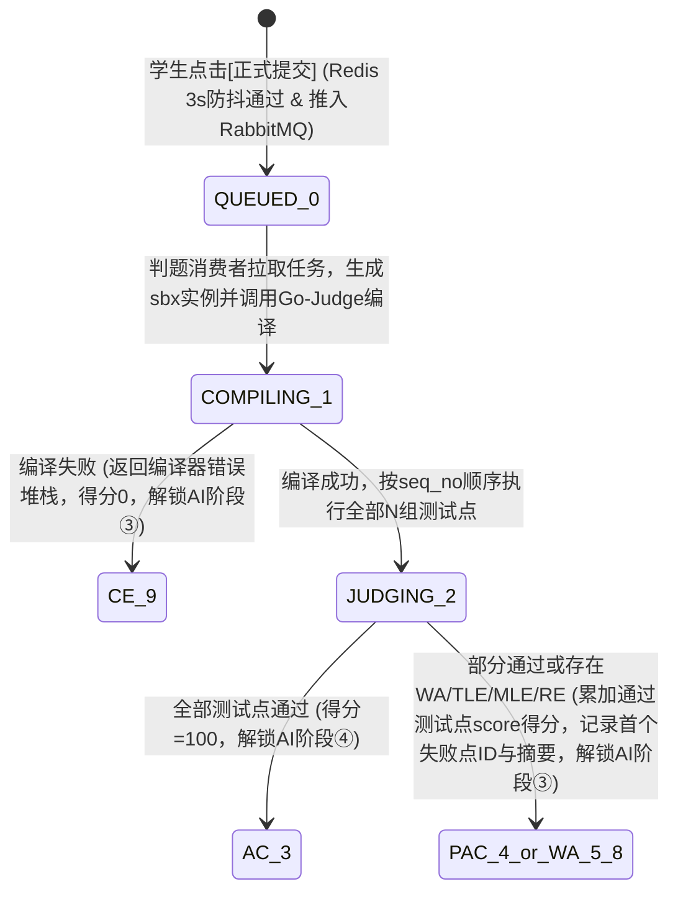
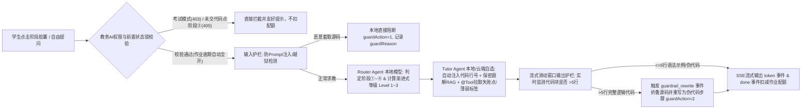

# 📄 文档一：《基于AI Agent与微服务架构的启发式智能在线判题系统》产品需求文档（PRD v2.0 终版）

> **文档版本：** v2.0.0（与《系统详细设计与前后端对接总规范 v2.0》87 个端点、17 张数据表、16 个原型页 100% 双向对齐）

## 一、 系统全局定位与微服务边界

### 1.1 技术栈基线
*   **前端架构：** 基于 **Alpine.js 响应式内核（`vendor/alpine.min.js`）+ 自定义 CSS Design Token 设计系统（`styles/tokens.css`，严格遵循 `_SPEC.md` 12 条设计硬规则）** 的零构建轻量化多页应用（MPA）；内置自定义在线代码编辑工作台（支持行号联动与考中内部剪贴板沙箱）、原生 SVG/CSS 学情可视化图表、基于 **`fetch + ReadableStream` 的自定义 SSE 流式客户端（`api/sse.js`）**、自适应轮询器（`api/poll.js`），以及支持断网全功能演示的 **`?mock=1` 离线双轨适配层（`api/` + `adapter/`）**。
*   **微服务底座：** JDK 17/21 + Spring Boot 3.2.x + Spring Cloud Alibaba（Nacos 注册/配置中心、OpenFeign 服务间 RPC 调用、Spring Cloud Gateway 统一网关）。
*   **数据与中间件：** MySQL 8.0（17 张核心业务表 + 1 张知识点字典表） + Redis（12 类缓存与分布式锁：鉴权会话、3s 防抖锁、AI 提示配额、渐进式提示等级、对话记忆、端云通道热插拔快照、全局序列号等） + RabbitMQ（判题任务异步削峰）。
*   **判题与 AI 引擎：** Docker 容器化 **Go-Judge** 安全评测内核（支持 C/C++、Java、Python，扩展 `instanceTag` 容器实例级可观测旁路） + **LangChain4j** 智能体编排框架 + **Ollama 本地模型（Qwen2.5-Coder-7B）** + **国内主流大模型 API（DeepSeek-V3 / 通义千问 Qwen-Coder / 智谱 GLM-4）**。

### 1.2 微服务架构划分（1 网关 + 5 核心服务，共 87 个 HTTP 端点）
1.  **`oj-gateway`（API 网关服务）**：统一入口路由、CORS 跨域、JWT + Redis 在线态逐字核验、`X-Trace-Id` 全链路追踪注入、接口防刷限流。
2.  **`oj-problem-service`（题库与知识库服务，`/api/problem/*` 共 13 个端点）**：题目 CRUD、**5 档难度体系**、题目状态流转（草稿/已发布/已归档，含乐观锁 `version`）、**逐测试点实体管理（`prob_test_case`）**、JSON 批量导入、**官方保密标准题解（RAG 知识源）**管理。
3.  **`oj-judge-service`（异步判题与沙箱调度服务，`/api/judge/*` 共 7 个端点）**：代码自测、多公开样例/自定义输入运行、正式提交（RabbitMQ 异步生产与消费）、1s 自适应状态轮询、提交历史与逐点明细、同题进步轨迹、对接 `Go-Judge` 容器沙箱评测与沙箱实例生命周期记录。
4.  **`oj-ai-agent-service`（启发式智能体服务，`/api/ai/*` 共 6 个端点）**：端云模型工厂动态路由与 8s 超时自动降级、Multi-Agent 协同工作流（Router + Tutor + Guardrail）、**三级渐进式脚手架提示**、**代码自动行号注入**、`@Tool` 内部工具调用、**SSE 六事件流式输出与滑动窗口代码护栏**、AI 回复有用性评价反馈（`ai_call_feedback`）。
5.  **`oj-teaching-service`（教务、认证与防作弊服务，`/api/auth/*` 5 个 + `/api/teaching/*` 40 个 = 45 个端点）**：双 Token 登录鉴权与动态角色菜单、班级与待办管理、练习/作业/考试发布、**整份作业提交与 5 秒内撤销（`assignment_submission`）**、考试试卷下发/代码草稿自动保存/交卷/服务端权威倒计时/前端切屏上报/教师端 **SSE 实时监考流（`exam_monitor_event`）**、班级与个人多维学情分析、**双阶段漏斗异步查重任务（`teach_plagiarism_task`）与相似代码片段行级对齐（`teach_plagiarism_segment`）**。
6.  **`oj-admin-service`（平台运维与治理服务，`/api/admin/*` 共 16 个端点）**：跨服务运维聚合，负责端云大模型通道 CRUD/启停/连通性真实探活（`probe`）/降级恢复（`recover`）、全站服务与中间件健康聚合、AI 调用与护栏命中审计（含 CSV 流式导出）、Go-Judge 沙箱容器实例监控/日志查看/强制终止回收（`DELETE`）、全站大盘统计。

---

## 二、 核心业务状态机流转规范

### 2.1 异步判题状态机（OI 按测试点权重计分模式）


### 2.2 启发式 AI 助教四阶段状态机与多智能体工作流


### 2.3 题目、作业与查重任务状态机
*   **题目生命周期（`prob_question.state`）：** `0 草稿` $\xrightarrow{\text{publish（校验测试点总分}=100\text{）}}$ `1 已发布` $\xrightarrow{\text{archive}}$ `2 已归档` $\xrightarrow{\text{restore}}$ `1 已发布`（严禁 `1→0` 退回草稿，保护历史提交外键完整性）。
*   **整份作业提交状态机（`assignment_submission.status`）：** `UNSUBMITTED` $\xrightarrow{\text{POST submit（写入 undo\_deadline\_at = now+5s）}}$ `SUBMITTED` $\xrightarrow{\text{5秒内 DELETE submit}}$ `UNSUBMITTED`（超 5 秒返回 `409 Conflict`）。
*   **异步查重任务状态机（`teach_plagiarism_task.state`）：** `PENDING` $\rightarrow$ `STAGE1（SimHash+AST粗筛）` $\rightarrow$ `STAGE2（AI抗混淆语义精筛）` $\rightarrow$ `DONE`（或 `FAILED`）。

---

## 三、 四大核心模块功能详情、业务规则、交互与验收标准

### 模块一：题库管理与在线异步判题模块（`oj-problem` & `oj-judge`）

| 维度              | 详细规格说明                                                 |
| :---------------- | :----------------------------------------------------------- |
| **功能详情**      | 1. **标准 I/O 题目与 5 档难度管理**：支持题目标题、**5 档难度（`1-入门 / 2-简单 / 3-中等 / 4-较难 / 5-困难`）**、主知识点与算法标签、基准时间/内存限制、各语言默认代码骨架、**教师专属保密标准题解（RAG 知识源）**录入，支持题目草稿/发布/归档流转（乐观锁 `version` 控制）与 JSON 批量导题。<br>2. **逐测试点实体化管理（`prob_test_case`）**：支持为题目配置有序测试点（`seq_no`）、**四档测试点类型（`sample 样例 / normal 普通 / edge 边界 / stress 构造`）**、单点分值 `score`（5 的倍数）及是否公开 `is_public`。<br>3. **在线编码与多模式运行**：提供【运行样例/自定义自测（`self-test` & `run-sample`）】与【正式提交（`submit`）】双通道，支持 C/C++（`C++ 17`）、Java（`Java 17`）、Python（`Python 3`）。 |
| **业务逻辑规则**  | 1. **OI 按测试点权重计分规则**：题目发布前强制校验所有有效测试点分值之和 $\sum_{i=1}^N \text{score}_i = 100$。正式提交会跑完该题全部 $N$ 组测试点，单次提交得分为**所有通过测试点的分值累加 $\text{oi\_score} = \sum_{i \in \text{Passed}} \text{score}_i$**。全部通过记为 `AC(3)`；部分通过或未通过记为 `PAC(4)/WA(5)/TLE(6)/MLE(7)/RE(8)`，并持久化记录**首个未通过的测试点序号 `first_failed_case_id` 及其输入输出脱敏摘要 `first_failed_summary`**。<br>2. **异构语言时空补偿规则**：以题目配置的 C/C++ 基准限制（如 `1000ms / 256MB`）为准，调用 Go-Judge 沙箱时对 **Java 和 Python 自动乘以 2 倍补偿系数（`2000ms / 512MB`）**。<br>3. **输出比对容错规则**：学生 `stdout` 与标准答案 `output_text` 比对前，统一按行执行 `stripTrailing()`（即 `rtrim()` 去除行末空格与 `\r`）并忽略文件末尾多余空行。 |
| **交互规则**      | 1. **自测 vs 提交隔离**：点击【运行】仅评测公开样例或自定义输入并在控制台回显，不写提交表、不计分、不改 AI 状态；点击【提交评测】触发异步判题。<br>2. **3s 防抖与 1s 自适应轮询**：点击后按钮置为 `Loading`，后端 Redis `oj:judge:lock:{uid}` 限制每 `3秒` 最多 1 次请求（超限返 `429`）。前端通过 `api/poll.js` 每 `1秒` 轮询判题结果（页面切后台自动暂停，达终态 `status>=3` 自动停止）；若结果为未满分终态，控制台展示引导文案（遵循 `_SPEC.md` 规范，**全站文案不含 Emoji**）：**`[第 X 号测试点未通过，点击让 AI 助教启发诊断反例]`**。 |
| **验收标准 (AC)** | - **AC-1.1**：提交死循环（`while(1)`）或超限内存（`1GB`）代码，沙箱在 `timeLimitMs × 倍率` 内精准中断并返回 `TLE(6)` 或 `MLE(7)`，容器自动回收（`exitCode=124/137`）。<br>- **AC-1.2**：单次自测响应 $\le 3$ 秒；RabbitMQ 队列支持 50 人并发提交零丢单；切后台暂停轮询，终态后 Network 面板零后续轮询请求。 |

---

### 模块二：端云协同启发式 AI Agent 模块（`oj-ai-agent`）

| 维度              | 详细规格说明                                                 |
| :---------------- | :----------------------------------------------------------- |
| **功能详情**      | 1. **四阶段渐进式启发对话**：覆盖 **①读题拆解（题意澄清）、②编码引导（思路启发）、③排错诊断（错因诊断）、④进阶复盘（复杂度优化）**。<br>2. **Tutor 模型自主切换與评价反馈**：支持在 **本地模型（Ollama Qwen2.5-Coder-7B）** 与 **云端模型（DeepSeek-V3 / 通义千问 / 智谱）** 间切换；支持学生对单条 AI 回复进行“有帮助/无帮助”评价反馈（`POST /api/ai/feedback`）。 |
| **业务逻辑规则**  | 1. **前置状态锁规则**：<br>   - 阶段①、②：练习模式下随时可用。<br>   - 阶段③（排错诊断）：**必须存在当前题目的非 AC（即 `status != 3`，含 `CE/WA/TLE/MLE/RE/PAC`）正式提交记录**，未解锁时提示 `"需至少提交 1 次评测（且未满分）后解锁"`。触发时后端**自动为学生代码注入行号（`1: #include...`）**，并通过 `@Tool` 自动拉取最新提交报错、保密标准题解 RAG 及首个失败测试点特征。<br>   - 阶段④（进阶复盘）：**必须存在当前题目的 AC（100分）正式提交记录**，未解锁时提示 `"需本题获得满分(AC)后解锁"`。触发时通过 `@Tool` 检索该生薄弱标签推荐关联进阶题。<br>2. **三级渐进式提示阶梯（脚手架策略）**：按学生在当前题目当前阶段的提问轮次自动递进 `hintLevel = min(count, 3)`（Level 1 方向反问 $\rightarrow$ Level 2 逻辑拆解与边界反例定位 $\rightarrow$ Level 3 填空式中文伪代码）。<br>3. **端云混合路由与 8s 自动降级**：`Router` 与 `Guardrail` 固定绑定本地 Ollama 模型；`Tutor` 按所选模型调用，若云端 API 超时（$>8$ 秒）或异常，自动发送 `fallback_notice` 事件无缝切换至本地 Ollama 模型继续回答。<br>4. **双层护栏与流式滑动窗口熔断**：输入侧拦截越狱套话（`guardAction=1`）；输出侧实时监测 SSE 流中 Markdown 代码块行数，允许 $\le 5$ 行语法片段，一旦检测到 `> 5` 行完整代码立即截断并发出 `guardrail_rewrite` 事件重写为伪代码步骤（`guardAction=2`），同时记录 `guardReason`（`LEAK_RATE / JAILBREAK / SENSITIVE_WORD / OVER_LENGTH_CODE`）。 |
| **交互规则**      | 1. **六事件 SSE 流式交互**：前端 `api/sse.js` 依次解析并渲染 `router_step`（路由与提示等级）、`tool_calling`（工具检索提示）、`fallback_notice`（降级黄条）、`token`（打字机输出）、`guardrail_rewrite`（护栏折叠替换）、`done`（唯一配额写入口，同步更新 `remainingQuota`）。 |
| **验收标准 (AC)** | - **AC-2.1**：SSE 流式首字响应时间（TTFT） $\le 2.5$ 秒；6 种事件在工作台均有对应 UI 表现。<br>- **AC-2.2**：输入 20 组典型索要源码/越狱指令，完整解题代码泄漏率为 **0%**，且准确计入审计页三分类统计。<br>- **AC-2.3**：断开外网模拟云端故障时，8 秒内自动触发 `fallback_notice` 降级至本地 Ollama 模型正常输出。 |

---

### 模块三：高校教务管理与双阶段防作弊模块（`oj-teaching`）

| 维度              | 详细规格说明                                                 |
| :---------------- | :----------------------------------------------------------- |
| **功能详情**      | 1. **三种教学活动与整份作业提交**：支持发布【平时练习(`1`)】、【课后作业(`2`)】、【期末考试(`3`)】；支持学生点击【交作业】提交整份作业并支持 **5 秒内撤销（`assignment_submission`）**。<br>2. **考中防作弊与 SSE 实时监考**：支持试卷下发、代码草稿自动保存、服务端权威倒计时、考中内部剪贴板沙箱与切屏上报、教师端 SSE 实时监考花名册与延时/收卷。<br>3. **双阶段漏斗异步查重与分段对齐**：支持发起异步查重任务、查看左右分栏相似代码片段（`segments`）行级对齐与 AI 鉴定评语、复核清零及撤销复核。 |
| **业务逻辑规则**  | 1. **三种模式的 AI 管控与逾期解锁规则**：<br>   - **平时练习**：开启 ①②③④ 全阶段 AI，不限次数。<br>   - **课后作业**：有效期内仅开启阶段 ① 和 ③，默认每题限 3 次（仅记录 `ai_used_count` 供教师端学情展示，**不扣减题目得分**）。**作业到达截止时间后，锁定正式成绩，允许学生继续提交作为“逾期补题练习（`is_overdue=1`）”，并自动解锁 ①②③④ 全部 AI 助教阶段且不限次数**。<br>   - **期末考试**：强制关闭全部 AI 接口（后端返回 `403`）。<br>2. **单题取历史最高分规则**：有效期内同一题多次提交，统一取**历史最高得分 `max_score`**（同分取耗时最短 `min_time_used`）。<br>3. **双阶段漏斗查重与定级规则**：<br>   - **样本池过滤**：抽取同班级、同题目、同语言下 `max_score >= 60` 的最高分提交源码。<br>   - **阶段 1（算法粗筛）**：剥离注释空白、归一化变量名后计算 $\text{structSim} = 0.4 S_{\text{sim}} + 0.6 S_{\text{ast}}$，将 $\ge 75\%$（阈值可调）的代码对筛入阶段 2。<br>   - **阶段 2（AI 语义精筛）**：提取相似片段 `segments[]` 并输出语义相似度 $\text{semSim}$ 与鉴定评语。定级：`structSim >= 75 && semSim >= 85` 为 `high`（高度疑似）；仅满足其一为 `suspect`（疑似）；否则为 `normal`。确认抄袭后保存原分至 `prev_max_score` 并将 `max_score` 清零（支持撤销复核恢复原分）。 |
| **交互规则**      | 1. **考中防作弊交互（预警标记模式）**：考试页拦截外部剪贴板粘贴（允许编辑器内部复制粘贴）；监听 `visibilitychange`，每次离开 $\ge 3$ 秒自动上报切屏并弹窗警告。达到阈值（默认 **`3` 次**，教师可配）**不强制锁卷**，在教师监考台标红预警并推送至监考 SSE 流。 |
| **验收标准 (AC)** | - **AC-3.1**：交作业后 5 秒内可撤销回未交状态，超 5 秒返回 `409`。<br>- **AC-3.2**：考试页刷新后倒计时不重置（与服务端误差 $<1$s）；切屏 $\ge 3$ 秒准确计数并实时推送至监考端。<br>- **AC-3.3**：50 人班级（约 1225 对）阶段 1 粗筛耗时 $\le 2$ 秒；阶段 2 对变量重命名与循环改写样本识别率 $\ge 90\%$。 |

---

### 模块四：平台运维与多模型/沙箱治理模块（`oj-admin`）

| 维度              | 详细规格说明                                                 |
| :---------------- | :----------------------------------------------------------- |
| **功能与规则**    | 1. **端云通道热插拔与探活恢复**：支持通道 CRUD、角色多选绑定（`ai_model_role`）、毫秒级超时配置（`timeoutMs`）、一键真实探活（`probe`）与降级手动恢复（`recover`），实时同步 Redis。<br>2. **AI 调用审计与沙箱实例运维**：支持按阶段/通道/护栏结果筛选调用记录、查看完整 Prompt 与回复抽屉、导出 CSV；支持查看 `Go-Judge` 沙箱实例（`sbx-xxxx`）实时 CPU/内存/存活时长、查看容器日志及强制终止回收（`DELETE`）。 |
| **验收标准 (AC)** | - **AC-4.1**：全站 16 个页面在 `?mock=1` 断网模式下 100% 可交互，且 DOM 结构、CSS 类名集合、`tokens.css` 与设计基线逐像素零差异，全站无 Emoji 字符。 |

---
---

# 🛠️ 文档二：《系统详细设计与前后端对接总规范（v2.0 修订补丁合集）》

以下为针对《v2.0 终极完整版设计文档.md》的 **4 处精准替换与增补章节**，打入后即可消除全部审计差异：

### 修订 1：表 3 (`teach_assignment`) 与 表 16 (`ai_chat_record`) 字段注释与默认值对齐
```sql
-- 替换 第3章 3.1 表3 teach_assignment 中的 tab_switch_limit 定义（默认值由 5 对齐为 3）：
  `tab_switch_limit` INT NOT NULL DEFAULT 3 COMMENT '考试切屏标红预警阈值(离开>=3s计1次, 默认3次, 对齐 s-exam.html:235)',

-- 替换 第3章 3.4 表16 ai_chat_record 中的 stage_type 定义（统一四阶段标准命名）：
  `stage_type` TINYINT NOT NULL COMMENT '所处阶段: 1-读题拆解(题意澄清), 2-编码引导(思路启发), 3-排错诊断(错因诊断), 4-进阶复盘(复杂度优化)',
```

### 修订 2：修正第 4 章 `#21`、`#28`、`#46` 响应报文（消除阶段③解锁冲突与 Emoji 违规）
```json
// 1. 替换 §4.3 端点 #21 GET /api/judge/status/{submissionId} 中的 aiStateUpdate（去除 Emoji）：
"aiStateUpdate": {
  "canUnlockStage3": true,
  "canUnlockStage4": false,
  "guideBtnText": "第 3 号测试点未通过（得分 80/100），点击让 AI 助教启发诊断反例"
}

// 2. 替换 §4.4 端点 #28 GET /api/ai/quota 响应示例（修正阶段③ lockReason 为“存在非AC提交后解锁”）：
{
  "code": 200,
  "message": "ok",
  "data": {
    "remaining": 2,
    "max": 3,
    "unlimited": false,
    "resetAt": 1761388800000,
    "stages": [
      {"stage": 1, "stageName": "读题拆解", "title": "题意澄清", "unlocked": true, "usedCount": 4, "hintLevel": 2, "lockReason": null},
      {"stage": 2, "stageName": "编码引导", "title": "思路启发", "unlocked": false, "usedCount": 0, "hintLevel": 1, "lockReason": "当前作业模式已禁用阶段②"},
      {"stage": 3, "stageName": "排错诊断", "title": "错因诊断", "unlocked": false, "usedCount": 0, "hintLevel": 1, "lockReason": "需至少提交 1 次评测（且未满分）后解锁"},
      {"stage": 4, "stageName": "进阶复盘", "title": "复杂度优化", "unlocked": false, "usedCount": 0, "hintLevel": 1, "lockReason": "需本题获得满分(AC)后解锁"}
    ],
    "channel": {"channelCode": "local-qwen", "channelName": "本地 Qwen", "healthStatus": "ON"}
  },
  "traceId": "7f3c..."
}

// 3. 替换 §4.5 端点 #46 POST /api/teaching/exam/tab-switch 响应示例（去除 Emoji 并对齐默认阈值 3）：
{
  "code": 200,
  "message": "ok",
  "data": {
    "tabSwitchCount": 3,
    "limit": 3,
    "redFlagTriggered": true,
    "alertMessage": "警告：您离开考试界面已达 3 次，系统已在教师监考台将您的试卷标红预警"
  },
  "traceId": "7f3c..."
}
```

### 修订 3：增补第 5 章 §5.3 核心业务算法与 Prompt 工程实现规范

```markdown
### 5.3 核心业务算法与 Prompt 工程实现规范

#### （1）判题适配层（`JudgeAdapter`）时空补偿、OI 权重计分与 `rtrim()` 比对算法
1. **异构语言时空补偿与唯一量纲换算：**
   - 读取 `prob_question` 的基准 `time_limit`（ms）与 `memory_limit`（MB）。若 `language` 为 `java` 或 `python`，自动执行 `effectiveTimeMs = timeLimit * 2`、`effectiveMemMb = memoryLimit * 2`。
   - 构造 Go-Judge `/run` 请求时，换算公式唯一固定为：`cpuLimit = effectiveTimeMs * 1_000_000L`（纳秒），`clockLimit = cpuLimit * 2`，`memoryLimit = effectiveMemMb * 1024L * 1024L`（字节）。
   - Go-Judge 返回的实测内存（字节）统一通过 `memoryUsedKb = (int) Math.round(rawBytes / 1024.0)` 换算为 KB 落库。
2. **输出 `rtrim()` 容错比对与 OI 按测试点分值累加：**
   - 将沙箱 `stdout` 与 `prob_test_case.output_text` 统一执行末尾空行裁剪，并对每一行执行 `line.stripTrailing()`（去除行尾空格及 `\r`）后逐行比对。
   - 若测试点 $i$ 比对一致，则 `gotScore = testCase.getScore()`，累加至总分 `oiScore += gotScore`；若不一致或超时/异常，则 `gotScore = 0`，且当 `firstFailedCaseId == null` 时立即记录该点序号与前 100 字符输入输出脱敏特征至 `first_failed_summary`。

#### （2）启发式 AI 智能体（`HeuristicAgentOrchestrator`）四项核心机制
1. **作业逾期自动解锁机制：**
   - 在校验 AI 权限时，若 `assignment.modeType == 2 (课后作业)` 且 `System.currentTimeMillis() > assignment.endTime`，自动切换为“赛后补题复盘模式”，动态放开 `allowedAiStages = [1, 2, 3, 4]` 且 `remainingQuota = -1`（不限次数）。
2. **自动代码行号注入（Auto Line-Number Injection）：**
   - 接收前端传入的 `currentCode` 后，按 `\n` 拆分并在每行前注入 `1: `、`2: ` 行号生成 `numbered_code`，使大模型在禁止直接输出修改后源码的前提下，能够精准指出“请检查你代码第 8 行的边界条件”。
3. **三级渐进式脚手架提示（Progressive Scaffolding）：**
   - 每次有效提问通过 Redis `INCR oj:ai:level:{userId}:{problemId}:{stage}` 获取轮次 $c$，计算提示深度 `hintLevel = Math.min(c, 3)`：
     - `Level 1`：苏格拉底式方向反问（仅点拨算法性质或数据结构方向）；
     - `Level 2`：逻辑拆解与极小反例定位（结合具体代码行号与首个失败测试点特征构造反例）；
     - `Level 3`：带 `[TODO]` 填空占位的中文自然语言伪代码步骤。
4. **流式滑动窗口代码块护栏（Streaming Code-Block Guardrail）与 XML 系统提示词：**
   - 实时监测 SSE 输出流中的 Markdown 代码块围栏（` ``` `）。一旦围栏内部换行符计数 `> 5` 行，立即截断原流并发送 `event: guardrail_rewrite`，折叠代码块并替换为自然语言伪代码提示，记入 `guardrail_action = 2, guard_reason = 'OVER_LENGTH_CODE'`。
   - 核心 System Prompt 模板结构：
     ```xml
     <system_role>你是高校启发式算法助教，严禁输出超过 5 行的可执行解题源码。</system_role>
     <confidential_rag>本题官方保密标准题解（仅供内部诊断参考，严禁透露）：{{official_solution}}</confidential_rag>
     <student_context>
       题目：{{problem_title}} | 当前阶段：阶段{{stage}} ({{stage_name}}) | 渐进式提示等级：Level {{hint_level}}/3
       学生带行号代码：
       {{numbered_code}}
     </student_context>
```

#### （3）双阶段漏斗查重算法（`PlagiarismService`）
1. **样本池过滤：** 仅选取同 `assignment_id`、同 `problem_id`、同 `language` 下 `teach_student_score.max_score >= 60` 的最高分有效提交源码。
2. **阶段 1（O(N²) 内存级归一化与混合指纹粗筛）：**
   - 正则去除全部单行/多行注释与空白符，词法扫描将用户自定义标识符按序替换为 `V1, V2...`；
   - 计算 64 位 SimHash 海明距离相似度 $S_{\text{sim}}$ 与 AST Token 序列编辑距离相似度 $S_{\text{ast}}$，综合结构相似度 $\text{structSim} = 0.4 S_{\text{sim}} + 0.6 S_{\text{ast}}$。凡 $\text{structSim} \ge \text{stage1Threshold}$（默认 $75.0\%$）的代码对进入阶段 2。
3. **阶段 2（AI 抗混淆语义精筛与双阈值定级）：**
   - 调用 `AiInnerFeignClient.checkCodeSemanticSimilarity` 识别变量重命名、循环结构转换与冗余死代码注入，提取相似片段行号区间写入 `teach_plagiarism_segment` 表，并计算语义相似度 $\text{semSim}$ 与综合相似度 $\text{overallSim} = (\text{structSim} + \text{semSim}) / 2$。
   - 风险定级：`structSim >= 75 && semSim >= 85` 判为 `high`（高度疑似）；仅满足其一判为 `suspect`（疑似）；其余为 `normal`。
```

### 修订 4：增补第 7 章 §7.3 考试界面内部剪贴板沙箱（防外部粘贴实现）

```js
/* 增补至 第7章 §7.3（挂载于 s-exam.html 的 examPage() 初始化中，不动 DOM 结构） */
initClipboardSandbox() {
  var self = this;
  this._internalClip = '';
  var area = document.getElementById('page-content');
  if (!area) return;
  this._onCopy = function () {
    var sel = window.getSelection ? String(window.getSelection()) : '';
    if (sel) self._internalClip = sel;
  };
  this._onPaste = function (e) {
    if (self.submitted) return;
    var cd = e.clipboardData || window.clipboardData;
    var text = cd ? cd.getData('text') : '';
    if (text && text !== self._internalClip) {
      e.preventDefault();
      if (window.OJ && OJ.toast) OJ.toast('考试模式下禁止粘贴外部剪贴板内容');
    }
  };
  area.addEventListener('copy', this._onCopy, true);
  area.addEventListener('cut', this._onCopy, true);
  area.addEventListener('paste', this._onPaste, true);
}
```

---

具体来说，你可以从以下两个层面来理解为什么不需要重改原型设计：

---

### 一、 为什么“原型视觉、布局与组件设计”完全不用动？

刚才我们对《PRD v2.0》和《系统详细设计 v2.0》做的 6 项修正，全部是**“让后端数据库、接口契约和文档说明去迁就你现有的原型页面”**，而不是反过来改原型：
1. **难度 5 档：** 原型里已经是 5 格难度刻度条（入门/简单/中等/较难/困难），我们是把后端从 3 档扩成了 5 档去匹配原型。
2. **测试点与查重分段：** 原型里的 `t-problem-edit.html`（测试点表）和 `t-plagiarism.html`（4 组相似代码段对齐）本来就已经设计好了，我们是在后端新增了 `prob_test_case` 和 `teach_plagiarism_segment` 表去支撑原型的展示。
3. **无 Emoji 规范与切屏 3 次阈值：** 原型规范 `_SPEC.md` 规定不用 Emoji、`s-exam.html` 写的是切屏 3 次，我们直接把后端返回的文案去除了 Emoji、把数据库默认阈值改成了 `3`。

因此，你现有的 16 个页面在 **DOM 层级结构、CSS 类名（`components.css / pages.css / shell.css`）、颜色与字号 Token（`tokens.css`）** 上**一行都不用改**，论文里的界面设计章节和原型截图可以直接定稿。

---

### 二、 后续写代码对接时，HTML 原型文件只需做哪 5 处“微创绑定调整”？

虽然**原型设计（长相与布局）**完全不用改，但在后续把静态原型变成真实前端代码（对接后端 API）时，你只需要在不改变任何视觉样式的前提下，对现有 HTML/JS 做以下 **5 处极小的属性与数据绑定修正**：

| 序号  | 涉及文件                                       | 微创修改内容（不改任何布局与样式）                           | 原因说明                                                     |
| :---: | :--------------------------------------------- | :----------------------------------------------------------- | :----------------------------------------------------------- |
| **1** | `index.html:198`                               | 将静态文案 `“所有页面均可直接打开、交互可用，不需要登录。”` 改为 `“所有页面均可直接打开浏览；进入工作区需要登录。”` | 对齐新增的鉴权体系                                           |
| **2** | `s-exam.html:143`<br>`t-problem-edit.html:233` | 将 `<body>` 上的 `data-page="s-assignments"` 修正为 `"s-exam"`；将 `data-page="t-problems"` 修正为 `"t-problem-edit"` | 修复原型里复制粘贴留下的侧边栏高亮错位笔误                   |
| **3** | `a-models.html:512`<br>`a-audit.html:946`      | 将 `x-for` 循环里的 `:key="c.at"` 改为 `:key="c.id"`（或 `c.recordId`） | 防止同一分钟内有多条调用记录时，时间戳相同导致 Alpine 渲染撞 Key |
| **4** | `s-workbench.html`                             | 将 `:class="{'is-focus':focusLine===N}"` 改为 `:class="{'is-focus':focusCase===N}"`，并删掉 `s-workbench.js` 里伪造的 `CASE_LINE`、`REPLIES` 和前端自减的 `quotaLeft` | 保持 `.is-focus` 样式不变，把数据源从硬编码假数据切换到真实判题与 SSE 流 |
| **5** | 15 个业务页页尾 + 新增 `login.html`            | 在各页 `shell.js` 与 `vendor/alpine.min.js` 之间插入 `api/`、`adapter/`、`boot.js` 的 `<script>` 引用；新增一个完全复用现有 `.card / .field / .btn` 样式的 `login.html` 登录页 | 挂载请求层、字段适配层与登录守卫                             |

