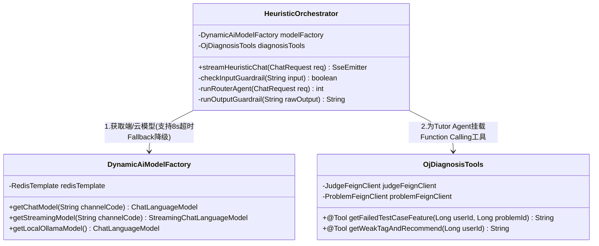

敲定**“现代清爽亮色风（全局清爽白+科技蓝，Monaco 编辑器支持一键切暗黑模式）”**后，系统的视觉规范就非常契合毕业论文截图与答辩演示了！

现在我们正式进入软件工程的核心阶段——**《系统详细设计与接口契约规范（Detailed Design & API Specification）》**。
为了让你能直接照着这份文档建表、写 Spring Cloud Controller 和 OpenFeign 接口，我将详细设计分为以下**三大核心部分**一次性为你完整呈现：
1. **第一部分：微服务数据库物理表详细设计（含核心建表 SQL 与字段映射）**
2. **第二部分：前后端 RESTful 接口设计与微服务内部 OpenFeign 接口设计（含请求/响应 JSON 报文）**
3. **第三部分：核心模块内部类结构与关键算法详细设计（端云路由工厂、异步沙箱调度、双阶段查重）**

---

# 📘 第一部分：微服务数据库物理详细设计（MySQL 8.0）

按照微服务数据隔离原则，4 个业务微服务逻辑上各自维护独立的表前缀（开发时可放在同一个 MySQL 实例的 `oj_cloud` 库中，通过表前缀区分领域边界，方便本地联调）。以下是最核心的 **8 张主表结构设计**：

### 1.1 题库与知识库服务 (`oj-problem-service`) —— 核心表：`prob_question`
支撑标准 I/O 判题、默认代码骨架、以及对学生隐藏的**官方标准题解（RAG 知识源）**。
```sql
CREATE TABLE `prob_question` (
  `id` BIGINT NOT NULL AUTO_INCREMENT COMMENT '题目主键ID',
  `title` VARCHAR(128) NOT NULL COMMENT '题目标题',
  `difficulty` TINYINT NOT NULL DEFAULT 1 COMMENT '难度: 1-简单, 2-中等, 3-困难',
  `tags` JSON NOT NULL COMMENT '算法标签JSON数组, 如 ["动态规划", "前缀和"]',
  `content` TEXT NOT NULL COMMENT '题目Markdown描述(含输入输出格式、样例)',
  `time_limit` INT NOT NULL DEFAULT 1000 COMMENT 'C/C++基准时间限制(ms), Java/Py自动x2',
  `memory_limit` INT NOT NULL DEFAULT 256 COMMENT 'C/C++基准内存限制(MB), Java/Py自动x2',
  `code_templates` JSON NOT NULL COMMENT '各语言默认代码骨架 {"cpp":"...", "java":"...", "python":"..."}',
  `test_case_dir` VARCHAR(255) NOT NULL COMMENT '测试用例(.in/.out)服务器存储目录路径',
  `test_case_count` INT NOT NULL DEFAULT 10 COMMENT '隐藏测试点总数(用于OI按点计分)',
  `official_solution` TEXT COMMENT '【核心RAG知识库】教师录入的隐藏标准题解与思路(对学生不可见, 仅供Tutor Agent检索)',
  `creator_id` BIGINT NOT NULL COMMENT '录入教师ID',
  `create_time` DATETIME NOT NULL DEFAULT CURRENT_TIMESTAMP,
  PRIMARY KEY (`id`)
) ENGINE=InnoDB DEFAULT CHARSET=utf8mb4 COMMENT='题库与隐藏题解RAG表';
```

### 1.2 异步判题服务 (`oj-judge-service`) —— 核心表：`judge_submission`
支撑 OI 按点计分、记录**首个失败测试用例编号及输出摘要**（供 AI 阶段③ `@Tool` 调用）。
```sql
CREATE TABLE `judge_submission` (
  `id` BIGINT NOT NULL AUTO_INCREMENT COMMENT '提交记录ID',
  `user_id` BIGINT NOT NULL COMMENT '提交学生ID',
  `problem_id` BIGINT NOT NULL COMMENT '题目ID',
  `assignment_id` BIGINT DEFAULT 0 COMMENT '关联教学活动ID(0代表平时自由题库练习)',
  `language` VARCHAR(16) NOT NULL COMMENT '语言: cpp / java / python',
  `code` TEXT NOT NULL COMMENT '学生提交的完整源代码',
  `status` TINYINT NOT NULL DEFAULT 0 COMMENT '状态机: 0-排队中(Pending), 1-编译中, 2-评测中, 3-AC, 4-PAC(部分通过), 5-WA, 6-TLE, 7-MLE, 8-RE, 9-CE',
  `oi_score` INT NOT NULL DEFAULT 0 COMMENT 'OI按点计分得分(0~100)',
  `pass_case_count` INT NOT NULL DEFAULT 0 COMMENT '通过的测试点数量',
  `total_case_count` INT NOT NULL DEFAULT 0 COMMENT '总测试点数量',
  `time_used` INT DEFAULT 0 COMMENT '最大测试点耗时(ms)',
  `memory_used` INT DEFAULT 0 COMMENT '最大测试点内存(KB)',
  `error_msg` TEXT COMMENT '编译错误(CE)或运行时异常(RE)堆栈信息',
  `first_failed_case_id` INT DEFAULT NULL COMMENT '【AI阶段③核心字段】首个未通过的测试点编号(如第3号)',
  `first_failed_summary` JSON DEFAULT NULL COMMENT '【AI阶段③核心字段】首个失败点的脱敏特征 {"input_preview":"5\\n-2 -1...", "expected_preview":"-1", "actual_preview":"0"}',
  `is_overdue` TINYINT NOT NULL DEFAULT 0 COMMENT '是否作业逾期补交: 0-正常, 1-逾期补题(不计入正式作业成绩)',
  `create_time` DATETIME NOT NULL DEFAULT CURRENT_TIMESTAMP,
  PRIMARY KEY (`id`),
  INDEX `idx_user_prob_assign` (`user_id`, `problem_id`, `assignment_id`)
) ENGINE=InnoDB DEFAULT CHARSET=utf8mb4 COMMENT='判题提交记录表';
```

### 1.3 启发式 AI 智能体服务 (`oj-ai-agent-service`) —— 核心表（2张）
1. **`ai_model_config`（端云大模型通道热插拔配置表）**
2. **`ai_chat_record`（四阶段启发式对话与护栏审计表）**
```sql
-- 表1：端云大模型通道配置表
CREATE TABLE `ai_model_config` (
  `id` BIGINT NOT NULL AUTO_INCREMENT,
  `channel_code` VARCHAR(32) NOT NULL UNIQUE COMMENT '通道编码: ollama_local / deepseek / qwen / zhipu',
  `channel_name` VARCHAR(64) NOT NULL COMMENT '前端下拉框展示名称, 如: 🟢本地极速(Qwen2.5-Coder)',
  `provider_type` VARCHAR(16) NOT NULL COMMENT '厂商类型: OLLAMA / OPENAI_COMPATIBLE',
  `base_url` VARCHAR(255) NOT NULL COMMENT 'API地址, 如 http://localhost:11434/v1 或 https://api.deepseek.com/v1',
  `api_key` VARCHAR(255) DEFAULT '' COMMENT '加密存储的API Key(本地Ollama为空)',
  `model_name` VARCHAR(64) NOT NULL COMMENT '模型标识: qwen2.5-coder:7b / deepseek-chat / glm-4-flash',
  `role_binding` VARCHAR(32) NOT NULL DEFAULT 'TUTOR_OPTIONAL' COMMENT '角色绑定: ROUTER_FIXED(路由固定) / GUARDRAIL_FIXED(护栏固定) / TUTOR_OPTIONAL(助教可选)',
  `is_enabled` TINYINT NOT NULL DEFAULT 1 COMMENT '状态: 1-启用, 0-禁用',
  PRIMARY KEY (`id`)
) ENGINE=InnoDB DEFAULT CHARSET=utf8mb4 COMMENT='端云大模型动态路由配置表';

-- 表2：AI启发对话记录表
CREATE TABLE `ai_chat_record` (
  `id` BIGINT NOT NULL AUTO_INCREMENT,
  `session_id` VARCHAR(64) NOT NULL COMMENT '会话ID(按 user_id + problem_id + assignment_id 聚合)',
  `user_id` BIGINT NOT NULL,
  `problem_id` BIGINT NOT NULL,
  `assignment_id` BIGINT DEFAULT 0,
  `stage_type` TINYINT NOT NULL COMMENT 'Router判定的阶段: 1-读题思路, 2-编码伪代码, 3-排错反例, 4-AC复盘推荐',
  `user_prompt` TEXT NOT NULL COMMENT '学生提问或点击胶囊触发的指令',
  `current_code` TEXT COMMENT '提问时编辑器内的代码快照',
  `tutor_model` VARCHAR(64) NOT NULL COMMENT '本次实际执行的模型(含自动降级后的模型名)',
  `ai_response` TEXT NOT NULL COMMENT '经Guardrail审查后的最终启发式回复',
  `guardrail_triggered` TINYINT NOT NULL DEFAULT 0 COMMENT '是否触发护栏拦截重写: 0-未触发, 1-输入防注入拦截, 2-输出超5行代码重写',
  `token_cost` INT DEFAULT 0 COMMENT '消耗Token数',
  `create_time` DATETIME NOT NULL DEFAULT CURRENT_TIMESTAMP,
  PRIMARY KEY (`id`),
  INDEX `idx_user_assign_prob` (`user_id`, `assignment_id`, `problem_id`)
) ENGINE=InnoDB DEFAULT CHARSET=utf8mb4 COMMENT='AI四阶段启发对话与护栏审计表';
```

### 1.4 教务与防作弊服务 (`oj-teaching-service`) —— 核心表（3张）
1. **`teach_assignment`（练习/作业/考试活动与 AI 策略配置表）**
2. **`teach_student_score`（学生单题最高分汇总与切屏/AI次数监控表）**
3. **`teach_plagiarism_report`（双阶段漏斗查重报告表）**
```sql
-- 表1：教学活动与AI策略表
CREATE TABLE `teach_assignment` (
  `id` BIGINT NOT NULL AUTO_INCREMENT,
  `title` VARCHAR(128) NOT NULL COMMENT '活动名称',
  `class_id` BIGINT NOT NULL COMMENT '绑定班级ID',
  `mode_type` TINYINT NOT NULL COMMENT '模式: 1-平时练习(AI全开), 2-课后作业(仅阶段①③且限次), 3-期末考试(AI全关+防作弊)',
  `allowed_ai_stages` JSON NOT NULL COMMENT '允许的AI阶段数组: 练习[1,2,3,4], 作业[1,3], 考试[]',
  `ai_quota_per_prob` INT NOT NULL DEFAULT -1 COMMENT '每题AI提示上限(-1不限, 作业默认3, 考试0)',
  `tab_switch_limit` INT NOT NULL DEFAULT 5 COMMENT '考试切屏标红预警阈值(默认5次)',
  `start_time` DATETIME NOT NULL,
  `end_time` DATETIME NOT NULL,
  `problem_ids` JSON NOT NULL COMMENT '包含的题目ID列表 [1001, 1024]',
  PRIMARY KEY (`id`)
) ENGINE=InnoDB DEFAULT CHARSET=utf8mb4 COMMENT='教学活动与AI策略配置表';

-- 表2：学生成绩汇总与考中监控表（维护历史最高分）
CREATE TABLE `teach_student_score` (
  `id` BIGINT NOT NULL AUTO_INCREMENT,
  `assignment_id` BIGINT NOT NULL,
  `user_id` BIGINT NOT NULL,
  `problem_id` BIGINT NOT NULL,
  `best_submission_id` BIGINT DEFAULT NULL COMMENT '【取历史最高分】最高分对应的提交ID',
  `max_score` INT NOT NULL DEFAULT 0 COMMENT '该题有效期内历史最高得分(0~100)',
  `ai_used_count` INT NOT NULL DEFAULT 0 COMMENT '【学情统计】该题已使用AI提示次数(仅记录不扣分)',
  `tab_switch_count` INT NOT NULL DEFAULT 0 COMMENT '【考中监控】切屏(>3秒)累计次数',
  `is_red_flagged` TINYINT NOT NULL DEFAULT 0 COMMENT '是否标红预警: 0-正常, 1-切屏超阈值预警, 2-查重判定抄袭(成绩清零)',
  PRIMARY KEY (`id`),
  UNIQUE KEY `uk_assign_user_prob` (`assignment_id`, `user_id`, `problem_id`)
) ENGINE=InnoDB DEFAULT CHARSET=utf8mb4 COMMENT='学生作业考试最高分与防作弊监控表';

-- 表3：双阶段漏斗代码查重报告表
CREATE TABLE `teach_plagiarism_report` (
  `id` BIGINT NOT NULL AUTO_INCREMENT,
  `assignment_id` BIGINT NOT NULL,
  `problem_id` BIGINT NOT NULL,
  `language` VARCHAR(16) NOT NULL,
  `user_a_id` BIGINT NOT NULL COMMENT '学生A ID',
  `sub_a_id` BIGINT NOT NULL COMMENT '学生A 最高分提交ID(得分>=60)',
  `user_b_id` BIGINT NOT NULL COMMENT '学生B ID',
  `sub_b_id` BIGINT NOT NULL COMMENT '学生B 最高分提交ID(得分>=60)',
  `stage1_algo_sim` DECIMAL(5,2) NOT NULL COMMENT '【阶段1粗筛】SimHash+AST归一化算法相似度(如 82.50%)',
  `stage2_ai_sim` DECIMAL(5,2) DEFAULT NULL COMMENT '【阶段2精筛】AI抗混淆语义相似度(如 96.00%)',
  `ai_model_used` VARCHAR(64) DEFAULT NULL COMMENT '阶段2鉴定使用的模型名称',
  `ai_diagnosis` VARCHAR(512) DEFAULT NULL COMMENT '阶段2 AI生成的抄袭特征鉴定评语(100字内)',
  `audit_status` TINYINT NOT NULL DEFAULT 0 COMMENT '教师裁定状态: 0-待裁定, 1-确认抄袭(已清零成绩), 2-排除嫌疑',
  `create_time` DATETIME NOT NULL DEFAULT CURRENT_TIMESTAMP,
  PRIMARY KEY (`id`),
  INDEX `idx_assign_prob` (`assignment_id`, `problem_id`)
) ENGINE=InnoDB DEFAULT CHARSET=utf8mb4 COMMENT='双阶段漏斗代码查重报告表';
```

---

# 📘 第二部分：接口详细设计（RESTful API & OpenFeign 契约）

全系统统一响应包装类 `Result<T>` 结构如下：
```json
{
  "code": 200,          // 200-成功, 400-参数或前置条件错误, 403-考试模式禁止访问AI, 429-提交过于频繁(3s防抖)
  "message": "success",
  "data": { ... }
}
```

### 2.1 前后端核心 RESTful 接口（经 `oj-gateway` 路由）

#### 接口 1：发起正式代码提交（异步削峰）
*   **路径：** `POST /api/judge/submit` （路由至 `oj-judge-service`）
*   **逻辑：** 校验 Redis 3秒防抖锁 $\rightarrow$ 校验考试是否已截止 $\rightarrow$ 落库生成 `Pending(0)` 记录 $\rightarrow$ 发送消息至 RabbitMQ `judge.submit.queue` $\rightarrow$ 立即返回 `submissionId`。
*   **Request Body:**
```json
{
  "problemId": 1024,
  "assignmentId": 15,
  "language": "cpp",
  "code": "#include <iostream>\nusing namespace std;\nint main() { ... }"
}
```
*   **Response JSON:**
```json
{
  "code": 200,
  "data": {
    "submissionId": "1849023849201",
    "status": 0,
    "statusDesc": "排队评测中..."
  }
}
```

#### 接口 2：轮询判题结果与解锁 AI 阶段状态
*   **路径：** `GET /api/judge/status/{submissionId}`
*   **Response JSON（以 OI 赛制部分通过 `WA` 为例）：**
```json
{
  "code": 200,
  "data": {
    "submissionId": "1849023849201",
    "status": 5,
    "statusText": "WA (答案错误)",
    "oiScore": 80,
    "passCaseCount": 8,
    "totalCaseCount": 10,
    "timeUsed": 12,
    "memoryUsed": 4096,
    "firstFailedCaseId": 3,
    "caseDetails": [
      {"caseId": 1, "status": "AC", "timeMs": 4},
      {"caseId": 2, "status": "AC", "timeMs": 5},
      {"caseId": 3, "status": "WA", "timeMs": 4}
    ],
    "unlockedAiStages": [1, 3],
    "highlightAiStage3": true
  }
}
```

#### 接口 3：启发式 AI 助教 SSE 流式对话接口（核心亮点接口）
*   **路径：** `POST /api/ai/chat/stream` （路由至 `oj-ai-agent-service`，响应头 `Content-Type: text/event-stream;charset=UTF-8`）
*   **Request Body:**
```json
{
  "problemId": 1024,
  "assignmentId": 15,
  "selectedChannelCode": "ollama_local",
  "clickedStageCapsule": 3,
  "userMessage": "为什么第3个测试点我没过？",
  "currentEditorCode": "#include <iostream>\n..."
}
```
*   **SSE 流式推送事件格式（支持展示 Multi-Agent 内部协同过程，答辩极度炫酷）：**
```text
event: agent_step
data: {"agent": "Router", "model": "qwen2.5-coder:7b(本地)", "stage": 3, "desc": "已识别为[阶段③：排错与反例诊断]，正在调用 @Tool 拉取第3号失败测试点..."}

event: token
data: {"content": "我通过内部诊断工具查看了你未通过的 **第 3 号测试点**。\n\n"}

event: token
data: {"content": "当输入数组全为负数（例如 `[-2, -1]`）时，你的状态转移初始值 `ans = 0` 会导致错误输出 `0`。你可以试着推演一下边界条件该如何初始化？"}

event: done
data: {"guardrailTriggered": false, "remainingQuota": 2, "actualModelUsed": "qwen2.5-coder:7b"}
```

#### 接口 4：考试前端切屏异常上报接口
*   **路径：** `POST /api/teaching/exam/tab-switch` （路由至 `oj-teaching-service`）
*   **Request Body:** `{"assignmentId": 18, "blurDurationSeconds": 6}`
*   **Response JSON:** `{"code": 200, "data": {"currentSwitchCount": 5, "limit": 5, "isRedFlagged": true, "warningMsg": "⚠️ 您已离开考试页面满5次，系统已在教师监考台将您标红预警！"}}`

#### 接口 5：触发“双阶段漏斗代码查重”接口
*   **路径：** `POST /api/teaching/plagiarism/check` （路由至 `oj-teaching-service`）
*   **Request Body:**
```json
{
  "assignmentId": 15,
  "problemId": 1024,
  "language": "cpp",
  "stage1Threshold": 75.0,
  "stage2ChannelCode": "deepseek"
}
```
*   **Response JSON:**
```json
{
  "code": 200,
  "data": {
    "validSampleCount": 46,
    "stage1TimeCostMs": 380,
    "stage1SuspiciousPairs": 5,
    "stage2HighRiskPairs": 2,
    "reportList": [
      {
        "reportId": 901,
        "userAName": "张三",
        "userBName": "李四",
        "stage1AlgoSim": 82.5,
        "stage2AiSim": 96.0,
        "aiDiagnosis": "两份代码虽然替换了全部变量名并将for改写为while，但状态转移方程与边界分支结构100%同构，判定为抗混淆抄袭。",
        "auditStatus": 0
      }
    ]
  }
}
```

---

### 2.2 微服务内部 OpenFeign 调用接口设计（服务间 RPC 契约）

在 `oj-common-api` 公共模块中定义以下 3 个核心 Feign 客户端，体现微服务之间的高内聚低耦合协作：

```java
// 1. 供判题服务与AI服务调用题库服务
@FeignClient(name = "oj-problem-service", path = "/inner/problem")
public interface ProblemFeignClient {
    // 获取题目评测配置与测试点路径(供 oj-judge-service 判题使用)
    @GetMapping("/judge-meta/{problemId}")
    ProblemJudgeMetaDTO getJudgeMeta(@PathVariable("problemId") Long problemId);

    // 获取题目描述与隐藏官方题解RAG(供 oj-ai-agent-service 的 Tutor Agent 使用)
    @GetMapping("/rag-solution/{problemId}")
    ProblemRagDTO getOfficialSolutionForAi(@PathVariable("problemId") Long problemId);

    // 根据薄弱标签推荐1~2道同类型进阶题(供 AI 阶段④ @Tool 工具调用)
    @GetMapping("/recommend")
    List<ProblemSimpleDTO> recommendByTag(@RequestParam("userId") Long userId, @RequestParam("tag") String tag);
}

// 2. 供AI服务(@Tool)调用判题服务
@FeignClient(name = "oj-judge-service", path = "/inner/judge")
public interface JudgeFeignClient {
    // 获取学生某题最新提交状态及首个失败测试点特征(供 AI 阶段③ @Tool 自动诊断调用)
    @GetMapping("/latest-diagnosis")
    SubmissionDiagnosisDTO getLatestFailedDiagnosis(@RequestParam("userId") Long userId,
                                                    @RequestParam("problemId") Long problemId,
                                                    @RequestParam("assignmentId") Long assignmentId);
}

// 3. 供判题服务与AI服务调用教务服务
@FeignClient(name = "oj-teaching-service", path = "/inner/teaching")
public interface TeachingFeignClient {
    // 判题完成后同步更新学生作业/考试单题历史最高分
    @PostMapping("/score/sync-highest")
    void syncHighestScore(@RequestBody ScoreSyncDTO scoreSyncDTO);

    // 校验当前教学模式下学生是否有权使用指定AI阶段，并校验剩余配额
    @GetMapping("/ai-permission/check")
    AiPermissionCheckDTO checkAiPermission(@RequestParam("userId") Long userId,
                                           @RequestParam("assignmentId") Long assignmentId,
                                           @RequestParam("problemId") Long problemId);
}
```

---

# 📘 第三部分：核心模块内部类结构与算法详细设计

### 3.1 `oj-ai-agent-service`：端云协同动态模型工厂与 `@Tool` 挂载设计



*   **端云无缝切换与熔断逻辑：**
    *   `DynamicAiModelFactory` 根据前端传入的 `selectedChannelCode`（如 `ollama_local` 或 `deepseek`）从 Redis 读取 `ai_model_config` 表配置，动态构建 `OpenAiStreamingChatModel`（由于 Ollama、DeepSeek、通义千问、智谱均兼容 `/v1/chat/completions` 协议，一套构建代码通吃所有本地与国内云端厂商！）。
    *   当调用云端模型抛出 `TimeoutException (>8s)` 或 `401/429` 异常时，`catch` 块自动调用 `getLocalOllamaModel()` 无缝接管输出。

### 3.2 `oj-judge-service`：对接 `Go-Judge` 容器沙箱评测算法设计
1.  **消费者拉取：** `JudgeMqListener` 监听 `judge.submit.queue`。
2.  **语言时空补偿计算：**
    ```java
    long timeLimitNs = meta.getTimeLimitMs() * 1_000_000L; // 转纳秒
    long memoryLimitBytes = meta.getMemoryLimitMb() * 1024L * 1024L;
    if ("java".equals(lang) || "python".equals(lang)) {
        timeLimitNs *= 2;
        memoryLimitBytes *= 2;
    }
    ```
3.  **调用 `Go-Judge` `/run` 接口：**
    *   C++/Java 先发一次编译请求，将编译产物 `fileId` 缓存在沙箱内存中；若返回非 0 退出码则直接标记 `CE` 并保存 `stderr`。
    *   遍历 $N$ 组 `.in` 文件，携带 `cpuLimit`、`memoryLimit`、`procLimit: 50` 请求沙箱执行。
    *   对沙箱返回的 `stdout` 与标准 `.out` 逐行执行 `line.stripTrailing()` 比对：通过则 `passCount++`；若首次遇到不匹配或超时，立即记录 `first_failed_case_id = i` 及脱敏摘要，继续跑完剩余测试点以计算最终 `oi_score = (passCount * 100) / totalCount`。

### 3.3 `oj-teaching-service`：双阶段漏斗查重算法详细设计
1.  **阶段 1（O(N²) 内存级极速粗筛，耗时 < 2s）：**
    *   **预处理归一化（Normalization）：** 使用正则表达式剥离所有 `//...`、`/*...*/` 注释及空白换行符；利用词法扫描将用户自定义标识符（非关键字）按出现顺序统一替换为 `VAR_1, VAR_2...`。
    *   **混合特征计算：** 计算归一化文本的 64位 `SimHash` 指纹海明距离相似度 $S_{sim}$，以及基于 Token 序列的 Levenshtein 编辑距离相似度 $S_{ast}$，综合得分 $S_1 = 0.4 S_{sim} + 0.6 S_{ast}$。
    *   若 $S_1 \ge 75\%$，加入 `suspiciousList`。
2.  **阶段 2（AI 抗混淆语义精筛）：**
    *   仅针对 `suspiciousList` 中的代码对，构造结构化 JSON Prompt 发送给 `oj-ai-agent-service`，要求大模型忽略变量名差异和 `for/while` 语法糖转换，专门对比**核心状态转移逻辑、辅助函数调用关系及边界条件分支**，直接输出 JSON：`{"semanticSimilarity": 96.0, "diagnosis": "..."}` 并落库。

---

### ✅ 详细设计与接口设计已完成！下一步你想怎么推进？

至此，从 **项目立项 $\rightarrow$ PRD 需求规格 $\rightarrow$ 原型设计 $\rightarrow$ 数据库与接口详细设计** 的全套工程文档已经全部对齐完毕！

接下来我们可以直接进入**动手实现/论文撰写阶段**，请告诉我你现在最需要哪一项：
1.  **👉 选项 A：【生成可直接运行的完整工程级核心代码与 Prompt 模板】**（为你写出 `oj-ai-agent-service` 的 Router/Tutor/Guardrail 三阶段完整 System Prompt、LangChain4j 端云工厂类代码、以及 `oj-judge-service` 调 Go-Judge 的核心 Java 代码）。
2.  **👉 选项 B：【生成前端核心页面（三栏做题工作台 + 双阶段查重台）的 Vue 3 / HTML 高保真代码】**（让你直接在浏览器里跑出高颜值界面，既能直接用于前端开发，又能立刻截图放进开题报告/论文）。
3.  **👉 选项 C：【输出毕业论文各章节撰写正文框架与图表清单】**。